<p align="center">
  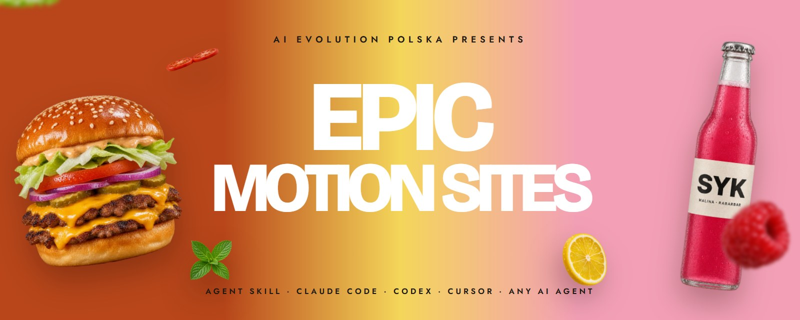
</p>

<h1 align="center">Epic Motion Sites</h1>

<p align="center">
  <b>A skill for AI agents that builds animated "wow" websites:<br>
  scroll-driven products exploding into layers, flavour sliders with a giant word, 3D galleries.</b><br>
  One HTML file. Photoreal AI product photos. Automatic verification in a real browser.
</p>

<p align="center">
  <a href="LICENSE"></a>
  <a href="skills/epic-motion-sites/SKILL.md"></a>
  
  
  
  
</p>

<p align="center">
  <a href="https://aievolutionpl.github.io/epic-motion-sites/examples/stak-burger/"><b>▶ Demo: STAK burger</b></a> ·
  <a href="https://aievolutionpl.github.io/epic-motion-sites/examples/syk-lemoniada/"><b>▶ Demo: SYK lemonade</b></a> ·
  <a href="#-installation">Installation</a> ·
  <a href="#-po-polsku">Po polsku</a>
</p>

---

## ✨ What it is

**Epic Motion Sites** is a packaged workflow for agents such as Claude Code, Codex and Cursor. It lets them build websites like the ones in award galleries (motionsites, Awwwards), instead of yet another template with three cards.

You give the agent one sentence, e.g. *"make a site for my burger bar in the style of motionsites"*. The agent then:

1. **picks a pattern** from 7 tested ones and writes a short story for the page (feeling, peak, signature move);
2. **generates photoreal AI product photos**, each element as a separate cutout on a transparent background;
3. **builds the site** as one `index.html` file: HTML + CSS + vanilla JS, no frameworks, no build step;
4. **walks it in a headless browser** on desktop and phone, takes screenshots of every scene and catches bugs on its own;
5. fixes what it finds, then **hands off** the result with a list of costs and placeholders.

## 🎬 Examples (built entirely by an agent with this skill)

### STAK — smash burger bar · pattern A: *Scroll Explode*
On scroll, the burger flies to the centre, **falls apart into 8 photoreal layers** with captions, then folds back together and lands on a plate.

<p align="center">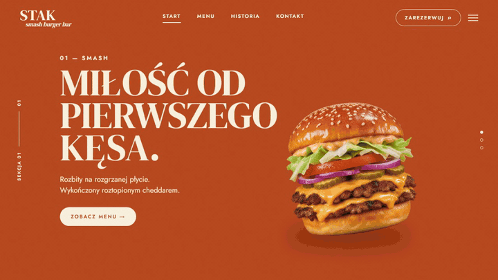</p>

| Hero | Ingredient ballet | Final |
|---|---|---|
| 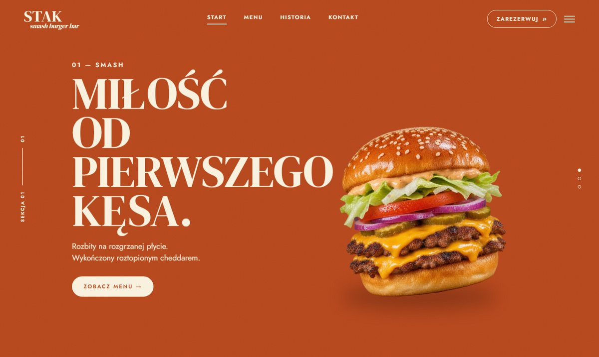 | 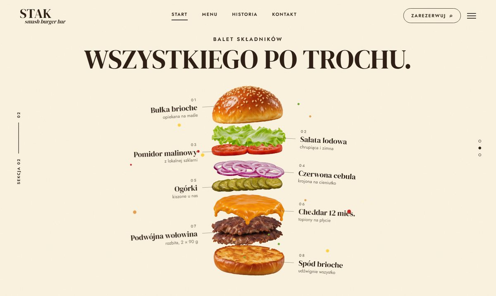 | 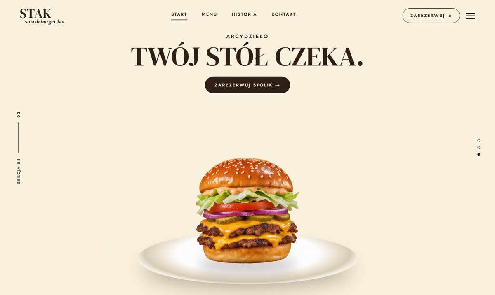 |

<details><summary><b>📱 STAK on a phone</b></summary>
<p align="center">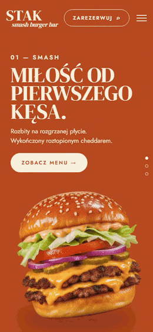 &nbsp; 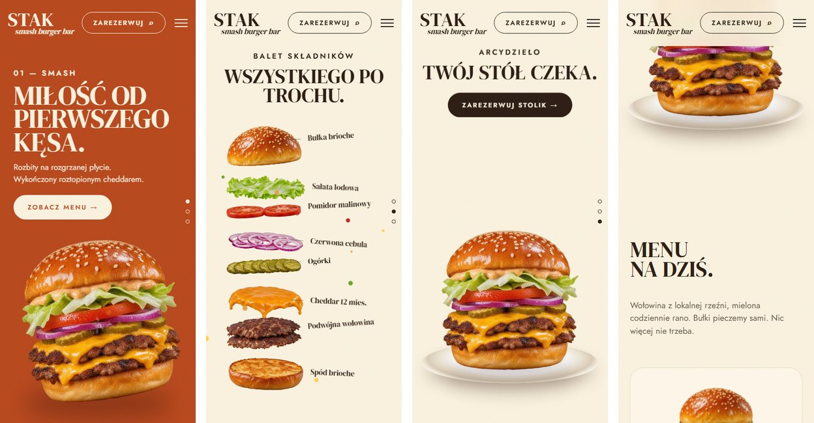</p>
</details>

### SYK — craft lemonade · pattern B: *Giant-Word Slider*
Each flavour has its own colour, a **giant word behind the bottle** and fruit floating at three depths (near and blurred, mid, far). The word, bottle and fruit move at different speeds.

<p align="center">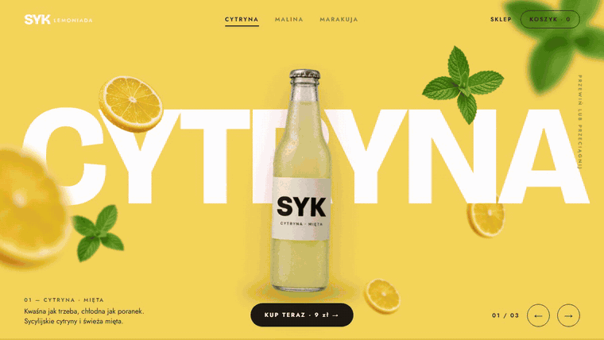</p>

| Cytryna | Malina | Marakuja |
|---|---|---|
| 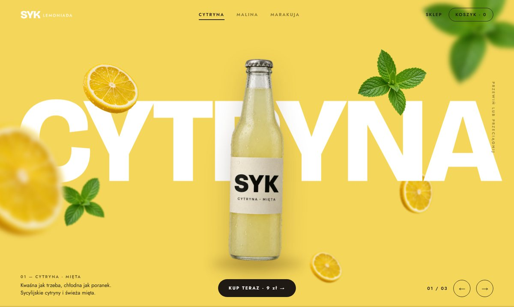 | 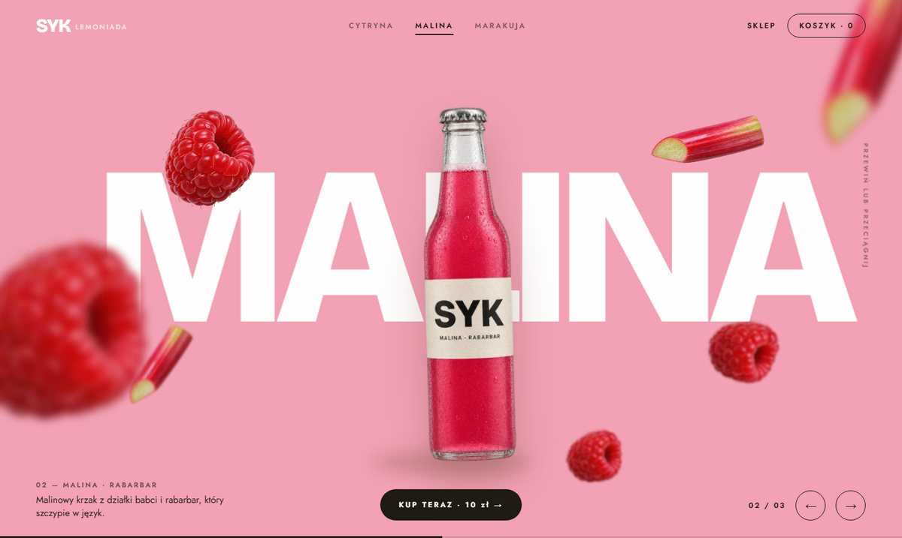 |  |

<details><summary><b>📱 SYK on a phone</b></summary>
<p align="center">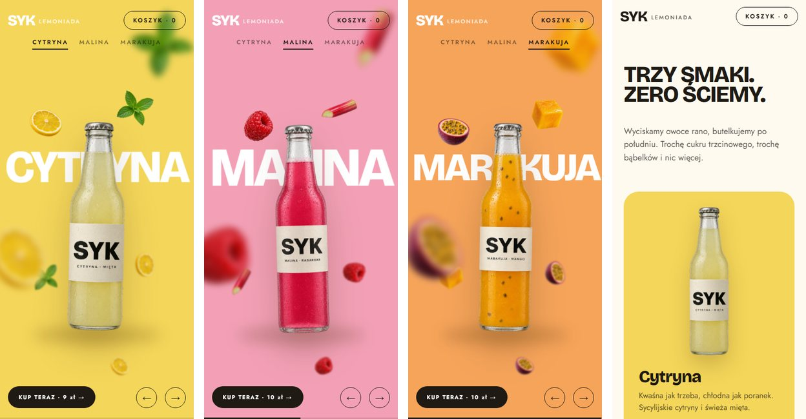</p>
</details>

> 💸 AI photos for both sites cost about **20 credits** in total (≈1 per image, 20 images including retakes).

## 🧩 7 patterns

| | Pattern | What happens | Best for |
|---|---|---|---|
| **A** | **Scroll Explode** | the product falls apart into captioned layers and folds back onto a plate | burgers, ramen, sneakers, gadgets, cosmetic sets |
| **B** | **Giant-Word Slider** | a giant word behind the product, parallax ingredients, the colour changes per flavour | drinks, smoothies, perfumes, colour variants |
| **C** | **Product Fan + Configurator** | a fan of products, the chosen one comes forward, "build your pack" | bars, snacks, coffee pods |
| **D** | **Cinematic Story** | a dark AI scene, a giant word rising from behind the foreground | venues, games, brand stories |
| **E** | **Living Hero** | the scene reacts to the cursor: glow and fireflies | agencies, portfolios, wellness |
| **F** | **3D Gallery Walk** | a CSS 3D corridor you walk through with scroll or drag | prints, collections, portfolios |
| **G** | **Shop-the-Look** | a carousel of models with hotspots and a side cart | fashion, bundles |

A and B come with **complete, tested templates**. C–G have a detailed recipe and a shared animation engine.

## 🔁 How it works

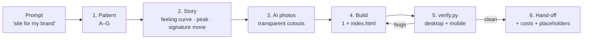

**The animation engine** is about 40 lines of vanilla JS. One smoothed value drives everything:

```js
cur += (target - cur) * .09;              // inertia
const ex = ss(.22,.46,p) - ss(.64,.80,p); // the "explode" phase: in, then out
layer.style.transform = `translateY(${(i-(N-1)/2) * GAP * ex}px)`;
```

There is no GSAP dependency. For complex sites the skill switches to **GSAP + ScrollTrigger** on its own and points to the official [GSAP skills](https://github.com/greensock/gsap-skills).

## 🔍 Automatic verification

The agent does not take its own word for it. `verify.py` (Playwright) scrolls the page to every key point on **1440×860 and 390×844**. It takes screenshots, builds a contact sheet and reports:

- console errors and **missing images**;
- horizontal overflow;
- **visible text running off the screen**;
- (for sliders) the state after each step, e.g. `go(1)`.

```text
$ python verify.py http://localhost:5517/ --mobile
== desktop 1440x860: 10 states -> shots/desktop-sheet.png
  OK - no automatic findings. Now read the sheet for overlaps and taste.
== mobile 390x844: 10 states -> shots/mobile-sheet.png
  WARN  [p=0.12] text outside viewport: <h1> "MIŁOŚĆ OD PIERWSZEGO KĘSA."
```

That warning is real: it caught bugs in both examples while they were being built, and the fixes are already in this repo.

## 🚀 Installation

**Any agent** (Claude Code, Codex, Cursor, Windsurf, Copilot, 40+ others) via the [skills CLI](https://github.com/vercel-labs/skills):
```bash
npx skills add https://github.com/aievolutionpl/epic-motion-sites
```

**Claude Code** as a plugin:
```text
/plugin marketplace add aievolutionpl/epic-motion-sites
/plugin install epic-motion-sites@aievolutionpl
```

**Manually:** copy the `skills/epic-motion-sites/` folder to:
- `~/.claude/skills/` (Claude Code, globally) or `.claude/skills/` (one project);
- `.agents/skills/` (Codex and others).

**Without skill support:** keep the repo in your workspace and type:
```text
Read skills/epic-motion-sites/SKILL.md and use it to build my website.
```

### Requirements
- Python 3.10+ with `pillow` and `playwright` (`pip install pillow playwright && playwright install chromium`)
- `ffmpeg`, only for `study_reference.py`
- An image generator for the photos, e.g. **Higgsfield**, **fal.ai** or any model that returns PNGs with a transparent background. Without one, the skill builds placeholders and tells you.

## 💬 Example prompts

```text
Make a site for my ramen bar where the ramen falls apart into ingredients on scroll.
```
```text
Landing page for a perfume line in 4 scents, slider style with a giant word behind the bottle.
```
```text
https://studio.motionsites.ai/explore/forge-gate - make something like this, but for my escape room.
```
```text
Art print shop: a 3D gallery you walk through, click a print → product card.
```

## 📁 Structure

```
epic-motion-sites/
├── skills/epic-motion-sites/
│   ├── SKILL.md                      ← workflow for the agent
│   ├── references/
│   │   ├── patterns.md               ← 7 patterns with choreography
│   │   ├── scroll-engine.md          ← vanilla animation engine + tests
│   │   ├── craft.md                  ← story, taste floor, refuse list
│   │   ├── ai-assets.md              ← AI photo prompts, costs, preparation
│   │   └── gsap.md                   ← when and how to switch to GSAP
│   ├── scripts/
│   │   ├── verify.py                 ← automatic check (Playwright)
│   │   ├── prep_assets.py            ← crop → WebP → contact sheet
│   │   └── study_reference.py        ← analyse a reference site's video
│   └── assets/
│       ├── template-scroll-explode.html
│       └── template-giant-word-slider.html
├── examples/                         ← live demos (GitHub Pages)
├── media/                            ← GIFs and screenshots for this README
└── .claude-plugin/                   ← Claude Code plugin manifest
```

## 🙏 Inspiration and credits

This repo combines the best of what we found, and credits it openly:

- **[studio.motionsites.ai](https://studio.motionsites.ai/explore)**: the gallery the 7 patterns were distilled from. We take patterns, never their images, logos or copy.
- **[greensock/gsap-skills](https://github.com/greensock/gsap-skills)** (MIT): the official GSAP skills. Our `gsap.md` defers to them for API details.
- **[nateherkai/scroll-craft](https://github.com/nateherkai/scroll-craft)** (MIT): the inspiration for the feeling curve, the single peak, the signature move, the refuse list and automated page walking. Rewritten in our own words for a lighter workflow.
- **[anthropics/skills](https://github.com/anthropics/skills)**: the Agent Skills format.

Full list: [CREDITS.md](CREDITS.md).

---

## 🇵🇱 Po polsku

**Epic Motion Sites** to skill dla agentów AI (Claude Code, Codex, Cursor i każdy agent czytający `SKILL.md`), który buduje animowane strony w stylu galerii nagród — w jednym pliku HTML:
- produkt rozpadający się na warstwy podczas scrolla;
- slider smaków z gigantycznym słowem i składnikami w paralaksie;
- sceny filmowe, hero reagujące na kursor, galerie 3D i shop-the-look.

Agent planuje historię strony (krzywa emocji, jeden szczyt, jeden ruch-podpis), generuje fotorealistyczne **wycinki AI na przezroczystym tle**, a na końcu **sam sprawdza stronę** w przeglądarce (desktop + telefon): brakujące obrazki, przewijanie w poziomie, tekst poza ekranem.

Instalacja: `npx skills add https://github.com/aievolutionpl/epic-motion-sites` albo w Claude Code `/plugin marketplace add aievolutionpl/epic-motion-sites`. Oba dema powyżej zbudował od początku do końca agent korzystający z tego skilla.

---

<p align="center">
  Made with 🔥 by <b>AI Evolution Polska</b> · MIT License<br>
  <sub>⭐ If it helped, leave a star. Pull requests with new patterns are welcome.</sub>
</p>
